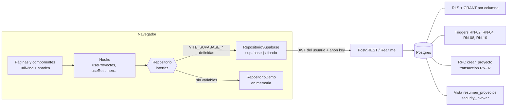
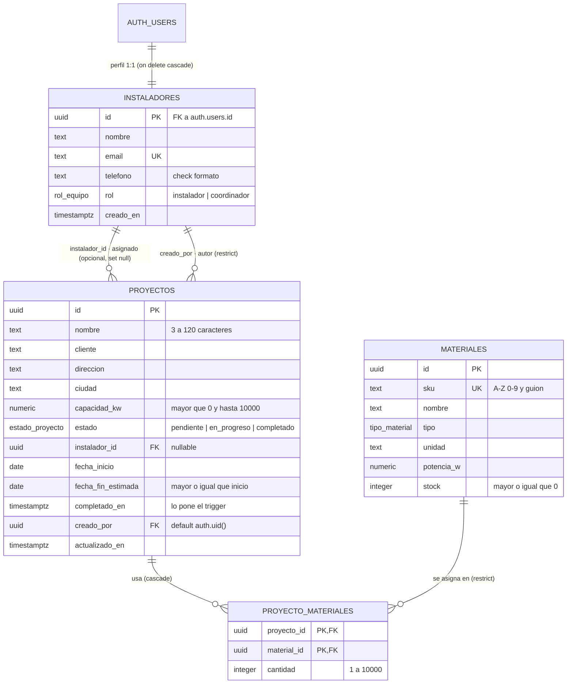

# Documento de Arquitectura · EcoFlow

Aplicación interna para gestionar proyectos de instalación solar. **Stack:** Supabase (Postgres + RLS + Auth + Realtime) · React 19 · TypeScript ~7.0 estricto · Vite 8 · react-router 8 · Tailwind CSS 4 con componentes al estilo shadcn/ui · zod 4 · Vitest 5 + PGlite.

Este documento explica **qué** se construyó, **por qué** tiene esa forma y **cómo** se usó la IA. El contrato completo que guía a la IA es [`ESPECIFICACION_TECNICA.md`](ESPECIFICACION_TECNICA.md) (prompt maestro). Todas las reglas se citan por su ID (`RN-*`, `SEG-*`, `UI-*`, `ARQ-*`).

---

## 1. Vista general



**Principio rector:** la seguridad vive en la base de datos. La interfaz oculta botones para que la experiencia sea clara, pero nunca es la que impide algo: si alguien llama a la API directamente con su JWT, Postgres aplica exactamente las mismas reglas.

---

## 2. Modelo de datos



### Decisiones y su justificación

| Decisión | Por qué |
|---|---|
| Tabla de unión **`proyecto_materiales`** (además de las 3 pedidas) | Proyectos ↔ materiales es N:M y necesita la **cantidad**. Un array o JSON en `proyectos` no permitiría FKs, ni descontar stock con un trigger, ni RLS por fila. La PK compuesta impide repetir un material. |
| `instaladores.id` **es** FK a `auth.users` | Perfil 1:1 con la cuenta de Supabase Auth: `auth.uid()` es directamente el id del instalador, sin joins en las políticas. |
| Coordinadores e instaladores en la **misma tabla** con `rol` | Ambos son "equipo"; las FKs `instalador_id` y `creado_por` apuntan al mismo sitio. El rol se guarda en la tabla (protegida por `GRANT` por columna) y **no** en `user_metadata`, que el usuario puede editar (SEG-03). |
| `instalador_id` **on delete set null** | Si alguien deja la empresa, el proyecto no se pierde: vuelve a quedar sin asignar. El CHECK `en_curso_con_instalador` impide que quede uno *en progreso* sin responsable, así que primero hay que reasignarlo. |
| `creado_por` **on delete restrict** | La auditoría no se borra en cascada. |
| `material_id` **on delete restrict** | No se puede borrar del catálogo un material que algún proyecto usa (la prueba lo confirma, SQLSTATE 23001). |
| **Restricciones con nombre** `proyectos_instalador_id_fkey` / `proyectos_creado_por_fkey` | Hay **dos** FKs hacia `instaladores`. PostgREST no sabe cuál usar al embeber (`PGRST201`), así que el frontend la indica: `instaladores!proyectos_instalador_id_fkey(...)`. |
| Enums de Postgres para estado, rol y tipo | El tipo TypeScript generado es una unión literal (`'pendiente' \| 'en_progreso' \| 'completado'`), así que el compilador detecta estados mal escritos. |
| Índices en `instalador_id`, `creado_por`, `material_id` y `estado` | Postgres **no** indexa FKs automáticamente y la política RLS filtra por `instalador_id` en **cada** consulta. |
| `CHECK` en la base de datos para todo rango | La validación del formulario (zod) es para la experiencia; la verdad está en la base de datos. Una prueba comprueba que ambos usan los mismos límites (ARQ-06). |

---

## 3. Seguridad: RLS justificada

Hay **dos capas**. `GRANT`/`REVOKE` deciden *qué operación* puede intentar un rol de Postgres (`anon`, `authenticated`) y las **políticas RLS** deciden *sobre qué filas*. Encima de ambas, los **triggers** aplican las reglas que dependen del cambio (de qué estado a qué estado).

### 3.1 Políticas

`es_coordinador()` es `SECURITY DEFINER` con `search_path = ''` (SEG-08): lee el rol saltándose la RLS de `instaladores` y así evita la recursión. Se llama como `(select public.es_coordinador())` y `(select auth.uid())` para que Postgres la evalúe **una vez por consulta** (initPlan) y no una vez por fila.

| Tabla | Operación | Política | Justificación |
|---|---|---|---|
| `proyectos` | SELECT | `instalador_id = auth.uid() or es_coordinador()` | **SEG-01**, el requisito central: cada instalador ve solo lo suyo. |
| `proyectos` | INSERT | `es_coordinador() and creado_por = auth.uid() and estado = 'pendiente'` | **SEG-02** solo coordinación crea; **SEG-07** nadie firma por otro; **RN-01** todo nace pendiente. |
| `proyectos` | UPDATE | USING y WITH CHECK: asignado o coordinador | El instalador puede actualizar **su** proyecto. WITH CHECK impide que se lo pase a otra persona. *Qué* columnas cambia lo limita el trigger (RN-10). |
| `proyectos` | DELETE | `es_coordinador() and estado = 'pendiente'` | **RN-09**: lo que ya empezó no se borra. |
| `proyecto_materiales` | SELECT | `exists (select 1 from proyectos where id = proyecto_id)` | La subconsulta **también pasa por la RLS de proyectos**: si no ves el proyecto, no ves sus materiales. SEG-01 se hereda sin duplicar la lógica. |
| `proyecto_materiales` | ALL | `es_coordinador()` | Solo coordinación asigna materiales. |
| `materiales` | SELECT | `true` (solo `authenticated`) | Es el catálogo interno, sin datos personales, y el formulario lo necesita. `anon` no tiene GRANT. |
| `materiales` | ALL | `es_coordinador()` | **SEG-02**: el catálogo lo gestiona coordinación. |
| `instaladores` | SELECT | `id = auth.uid() or es_coordinador()` | Un instalador no puede listar al equipo (teléfonos, correos). |
| `instaladores` | UPDATE | `id = auth.uid()` **+** `GRANT UPDATE (nombre, telefono)` | **SEG-03**: la política deja editar tu fila, y el GRANT por columna impide tocar `rol`. Sin el GRANT, un instalador podría hacerse coordinador. |

### 3.2 Privilegios y triggers

- `REVOKE ALL ... FROM anon` (**SEG-05**). Supabase da `GRANT ALL` por defecto a `anon` y `authenticated` sobre lo que se crea en `public`.
- `REVOKE TRUNCATE` a `authenticated`, porque `TRUNCATE` **no pasa por RLS**.
- Trigger `al_registrar_usuario` (**SEG-04**): crea el perfil siempre como `instalador`, aunque el registro envíe `{"rol":"coordinador"}` en la metadata.
- Trigger `proyectos_reglas`:
  - **RN-02**: solo `pendiente→en_progreso→completado`; si no, error `23514`.
  - **RN-04**: fija `completado_en` en el servidor.
  - **RN-10**: si el usuario es instalador, compara `to_jsonb(new)` con `to_jsonb(old)` sin `estado`; si cambió otra cosa, error `42501`.
- Trigger `ajustar_stock_material` (**RN-08**): `update materiales set stock = stock - n where id = … and stock >= n`. Si no actualiza ninguna fila, lanza `P0001`. El `UPDATE` bloquea la fila, así que dos coordinadores no pueden asignar a la vez el último inversor.
- RPC `crear_proyecto(...)` (**RN-07**): es **`SECURITY INVOKER`**, así que corre con los permisos de quien llama y la RLS se aplica dentro. Se usa **solo** para la atomicidad: proyecto + materiales + stock en una transacción. Si falta stock para un material, no queda nada a medias.

### 3.3 Vista del dashboard

`resumen_proyectos` se define `with (security_invoker = true)` (**SEG-06**). Es el problema técnico de la sección 6.

---

## 4. Estructura del frontend

```
src/
├── types/database.ts          ← tipos del esquema (formato `supabase gen types`), propuestos por la IA y verificados
├── lib/
│   ├── dominio.ts             ← tipos de negocio DERIVADOS de database.ts + reglas puras (siguienteEstado, puedeAvanzar)
│   ├── validacion.ts          ← zod por campo + reglas cruzadas; límites = CHECK de la BD
│   ├── errores.ts             ← SQLSTATE → mensaje en español (42501, 23514, P0001…)
│   └── repositorio/
│       ├── tipos.ts           ← interfaz Repositorio (contrato de datos)
│       ├── supabase.ts        ← implementación real (único archivo que importa supabase-js)
│       ├── demo.ts            ← implementación en memoria con las mismas reglas (modo demo y pruebas)
│       ├── crear.ts           ← elige la implementación; supabase-js se importa de forma diferida
│       └── contexto.tsx       ← RepositorioProvider / useRepositorio (inyección de dependencias)
├── hooks/
│   ├── useConsulta.ts         ← { datos, cargando, error, recargar }; descarta respuestas obsoletas
│   ├── useSesion.tsx          ← perfil + rol; SesionProvider
│   ├── useProyectos.ts        ← lista + avance optimista con reversión + realtime
│   └── datos.ts               ← useResumen, useProyecto, useInstaladores, useMateriales, useCrearProyecto
├── components/
│   ├── ui/                    ← button, card, badge, campos, alert (shadcn: cva + tailwind-merge)
│   ├── estados.tsx            ← CargandoFilas, ErrorCarga (con reintento), Vacio
│   ├── EstadoBadge, TarjetasResumen, TablaProyectos, Layout
└── pages/                     ← Dashboard, NuevoProyecto (lazy), DetalleProyecto (lazy), Login
```

**Patrones clave:**

1. **Repositorio + Context (ARQ-02/03).** Los componentes no conocen Supabase. Esto permite:
   - el **modo demo** sin backend (UI-08);
   - pruebas de UI con un repositorio falso (`{ ...demo, cambiarEstado: vi.fn().mockRejectedValue(...) }`);
   - cambiar de proveedor sin tocar las páginas.
2. **Hooks con estados explícitos (ARQ-04, UI-05).** Cada vista maneja carga (esqueletos), error (alerta con *Reintentar*) y vacío. `useConsulta` numera las peticiones e ignora una respuesta lenta que llega después de una más nueva; por ejemplo, si cambias de usuario a mitad de una carga, no aparecen datos del usuario anterior.
3. **Actualización optimista (UI-03).** *Iniciar* o *Completar* cambia la fila al instante. Si Postgres lo rechaza (RLS, transición inválida), se revierte y se muestra el motivo traducido.
4. **Realtime (UI-07).** `postgres_changes` sobre `proyectos`, que respeta RLS: cada instalador solo recibe eventos de sus proyectos. Ante un evento se hace una recarga silenciosa.
5. **Formulario (UI-04).**
   - Todos los campos son texto y se validan con `validarProyecto()` **antes** de cualquier petición.
   - Los errores se muestran por campo, con `aria-invalid` y `aria-describedby`, y el foco va al primer error.
   - El stock se valida con el inventario que se tiene en ese momento.
   - Luego la RPC vuelve a validar todo en la base de datos.
6. **TypeScript estricto en todo el código:**
   - Sin `any` ni `@ts-ignore`.
   - Con `noUncheckedIndexedAccess`.
   - Los tipos de dominio se **derivan** de `database.ts` (`Tables<'proyectos'>`, `Enums<'estado_proyecto'>`). Si cambia el esquema, el compilador señala cada uso.

---

## 5. Tipos TypeScript generados con IA (y verificados)

Lo normal sería ejecutar `supabase gen types typescript --project-id …`. Sin un proyecto conectado, se le pidió a la IA:

> «A partir de la migración `20261120120000_esquema_ecoflow.sql`, genera `src/types/database.ts` con **exactamente** el formato de `supabase gen types typescript` (Row/Insert/Update, Relationships con el nombre de cada FK, Views, Functions, Enums, helpers `Tables<>`/`Enums<>` y `Constants`). En `Insert`, una columna es opcional solo si tiene DEFAULT o admite NULL. Las columnas de una vista son todas nullable. No inventes columnas.»

**No se copió a ciegas.** `supabase/tests/tipos.test.ts` (12 pruebas) aplica la migración en Postgres real (PGlite) y compara el archivo con `information_schema` y `pg_catalog`:

- columnas y nulabilidad de cada `Row`;
- qué campos son opcionales en `Insert`;
- valores de los enums frente a `Constants`;
- argumentos y defaults de `crear_proyecto`;
- el nombre de cada FK en `Relationships` frente a `pg_constraint`.

Como prueba de mutación, se alteró a propósito `database.ts`:

- una columna con la nulabilidad cambiada;
- un `Insert` opcional que no debía serlo;
- un valor de enum.

Las pruebas fallaron (3 fallos), así que detectan errores reales.

Además, supabase-js analiza el texto del `select` **a nivel de tipos**. El compilador verifica que el `select` con *embedding* devuelve exactamente `Proyecto` y `ProyectoDetalle`. Si la IA escribe mal una columna del embed, `tsc` falla.

---

## 6. Problema técnico complejo resuelto con IA

### El dashboard filtraba los totales de toda la empresa a cada instalador

**Contexto.** UI-01 pide indicadores por estado calculados en la base de datos. La solución natural es una vista con `count(*) group by estado`. Las políticas de `proyectos` ya filtraban por instalador, así que parecía seguro.

**El problema.** En Postgres, una vista se ejecuta con los permisos **de su dueño** (`postgres`, que en Supabase se salta RLS), no con los de quien la consulta. Andrés, con 1 proyecto, veía en sus tarjetas **"2 pendientes · 1 en progreso"**, los números de toda la empresa. No es una fuga de filas sino de **agregados**. Es sutil, porque la tabla de proyectos sí estaba bien protegida y ninguna prueba de "¿puedo leer esta fila?" lo detecta.

**Cómo se resolvió con la IA:**

1. En el prompt maestro se escribió la regla **SEG-06**: *"los agregados del dashboard respetan RLS"*. Así la IA tuvo que tratar la vista como un objeto de seguridad, no como una comodidad.
2. Se le pidió una prueba que demostrara la regla **y un control negativo**. La prueba `control: la MISMA vista sin security_invoker…` crea la vista ingenua y comprueba que Andrés **sí** ve los totales globales (`{pendiente: 2, en_progreso: 1}`). Eso confirma que el riesgo es real y no teórico.
3. La IA propuso `with (security_invoker = true)` (Postgres ≥ 15, disponible en Supabase). Con eso la vista se evalúa con el rol `authenticated` del usuario y la RLS de `proyectos` se aplica dentro.
4. **Verificación:**
   - Andrés ve `{pendiente: 1, en_progreso: 0, completado: 0}` y la coordinadora ve los globales.
   - Mutación: al quitar `security_invoker`, la prueba SEG-06 falla.
5. El mismo cuidado se aplicó en el modo demo: `RepositorioDemo.resumen()` calcula solo sobre los proyectos visibles, y una prueba lo comprueba.

### Otros problemas que la verificación detectó en propuestas de la IA

| # | Propuesta inicial | Qué la detectó | Corrección |
|---|---|---|---|
| 1 | Embed `instaladores(id, nombre)` en `proyectos` | Revisión contra el esquema: con 2 FKs hacia `instaladores`, PostgREST responde `PGRST201` | Restricciones con nombre + hint `!proyectos_instalador_id_fkey`. |
| 2 | `select` armado con `+` | `tsc`: el resultado se tipaba como `GenericStringError` | Un solo literal de plantilla: supabase-js necesita el texto literal para inferir el tipo. |
| 3 | Reglas cruzadas (stock, repetidos) en `superRefine` de zod | Prueba de validación: si otro campo fallaba, **no se ejecutaban**, y el usuario veía los errores por tandas | Se movieron a `erroresCruzados()`, que se evalúa siempre. |
| 4 | Borrar material en uso → esperar `23503` | Prueba en PGlite: Postgres responde `23001` (`restrict_violation`) con `on delete restrict` | Se corrigió la expectativa y se documentó. |
| 5 | Seed con stock "final" como stock inicial | El trigger RN-08 rechazó el seed (*Stock insuficiente*) | Stock inicial = final + asignado; una prueba exige que el seed y el modo demo terminen con el mismo inventario. |
| 6 | `useConsulta` sin prueba de respuestas obsoletas | Mutación: quitar la protección **no** hacía fallar ninguna prueba | Se agregó una prueba con promesas controladas que llegan en desorden. |

---

## 7. Uso estratégico de la IA: prompts clave

Cada conversación empieza pegando el prompt maestro completo. Después se usan prompts acotados que **citan IDs** y **exigen la prueba** (redacción condensada):

1. **Esquema.** *«Con la sección 2 y las reglas RN/SEG, escribe UNA migración idempotente para Supabase. Pon cada regla en el mecanismo de la tabla SEG (RLS, GRANT o trigger) y comenta el ID junto a cada línea. Antes de escribir SQL, lista qué regla va en qué mecanismo y por qué.»*
2. **Pruebas de RLS.** *«Escribe pruebas Vitest sobre PGlite que se hagan pasar por cada rol como lo hace PostgREST (`set local role` + `request.jwt.claims`). Al menos una prueba por cada RN y SEG, y para SEG-06 un control negativo que demuestre la fuga sin `security_invoker`.»*
3. **Tipos.** El prompt de la sección 5, más: *«Después escribe la prueba que compare tu archivo con `information_schema`.»*
4. **Capa de datos.** *«Implementa la interfaz `Repositorio` (ARQ-02) con supabase-js tipado. Ningún `as`: si un tipo no cuadra, el `select` está mal. Traduce los SQLSTATE de los triggers a mensajes en español.»*
5. **Formulario.** *«UI-04: formulario controlado con validación antes de enviar. Los límites salen de `LIMITES`, que debe coincidir con los CHECK. Errores por campo y accesibles. Escribe una prueba que garantice que, con datos inválidos, `crearProyecto` NO se llama.»*
6. **Revisión.** *«Revisa este diff contra el prompt maestro: ¿qué regla no tiene prueba? ¿Qué prueba seguiría pasando si se borrara la regla?»* De aquí salieron las pruebas de mutación.

**Qué no se delegó:**
- las decisiones de la tabla de la sección 2;
- la elección de *qué* mecanismo aplica cada regla;
- la revisión de cada resultado contra una prueba ejecutable.

---

## 8. Verificación y límites

- `npm run typecheck` · `npm test` (**84 pruebas**: 44 de base de datos en PGlite y 40 de frontend) · `npm run build`.
- Prueba manual en el navegador, en modo demo:
  - coordinadora: dashboard, filtros, avance de estado, creación con validación de stock y redirección al detalle;
  - instalador: ve solo 2 proyectos, sin botón de crear, con acceso restringido a `/proyectos/nuevo` y a proyectos ajenos.

**No probado contra un Supabase real** (no hay proyecto conectado en este entorno):
- Auth real (login por correo);
- la resolución del hint de embedding por PostgREST;
- la llamada RPC por HTTP;
- la entrega de eventos de Realtime filtrados por RLS;
- la salida exacta de `supabase gen types`.

La lógica SQL sí se ejecutó en Postgres 18 (PGlite) con una réplica de los roles, `auth.uid()` y los privilegios por defecto de Supabase. Lo que falta es la capa HTTP. La sección *Despliegue* del README explica cómo verificarlo.
